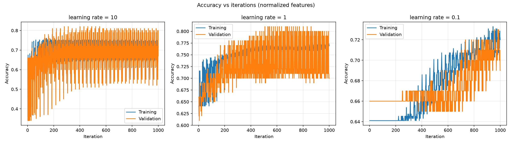

# Logistic regression from scratch

Logistic regression written by hand in NumPy (no scikit-learn) to predict diabetes from 8 clinical features in the Pima Indians dataset: glucose, BMI, age, insulin and so on.

I wanted to see what actually happens inside training instead of calling `.fit()`. So the sigmoid, the cross-entropy loss, the gradients, mini-batch gradient descent and L2 regularization are all written out, and every run logs train/validation accuracy and loss at each step.

## The interesting part

On the raw features, almost every learning rate blew up. Anything from 0.001 upward overflowed: the features live on very different scales (insulin goes into the hundreds, the pedigree function is under 1), so one big gradient step pushes the sigmoid to exactly 0 or 1 and the loss turns into infinity. The only stable setting was a tiny learning rate of 0.0001, and that topped out at **67.5% test accuracy**.

Min-max scaling the features (fit on the training set only) fixed it. Training became stable at a learning rate of 1, which is 10,000x larger, and test accuracy went up to **77%**.

| Setup | Learning rate | Iterations | Test accuracy |
|---|---|---|---|
| Raw features | 0.0001 | 100 | 67.5% |
| Min-max normalized | 1 | 1000 | 77.0% |



## Other experiments in the script

- A full learning rate sweep (10,000 down to 0.00001) at 10, 100, 1,000 and 10,000 iterations, for raw and normalized features. Runs that overflowed are flagged.
- Batch sizes from 4 to 64.
- L2 regularization strengths from 0 to 10.
- Shuffling the training data with different seeds. On raw features the result swings a lot between seeds. On normalized features it barely moves.

All plots are saved to `figures/`.

## Run it

```bash
pip install numpy pandas matplotlib
python logistic_regression.py
```

The data is already split into `data/diabetes_train.csv` (468 rows), `diabetes_dev.csv` (100) and `diabetes_test.csv` (200).
